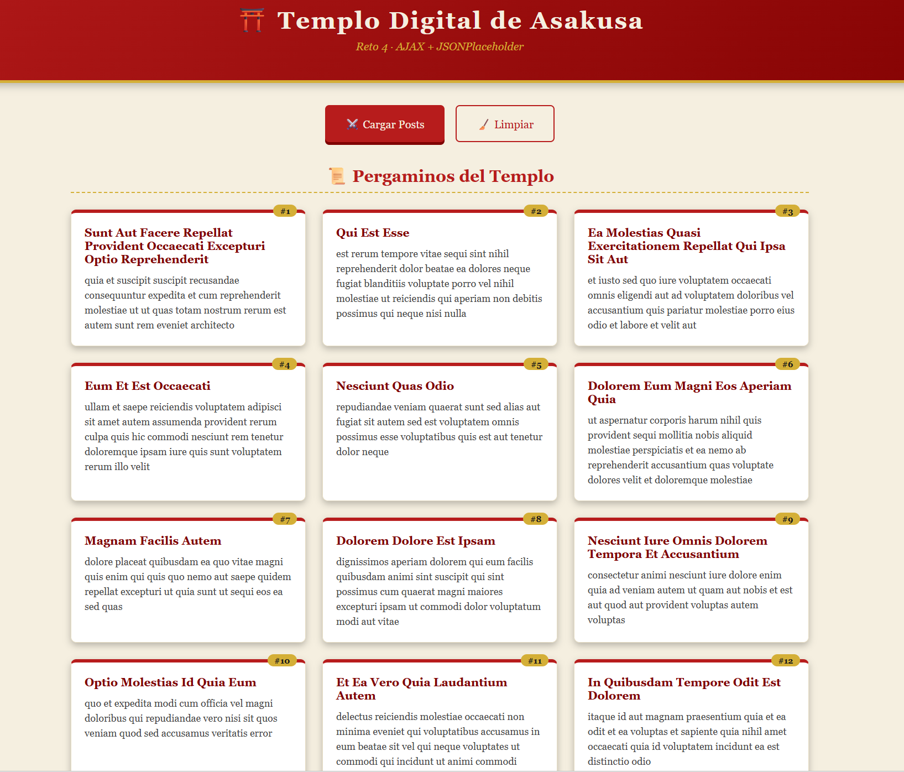
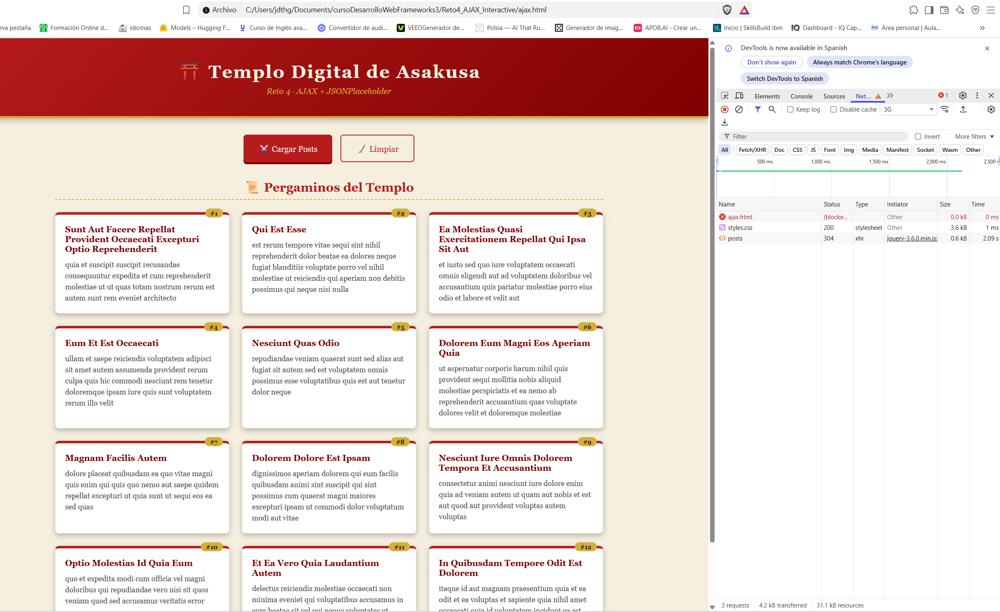
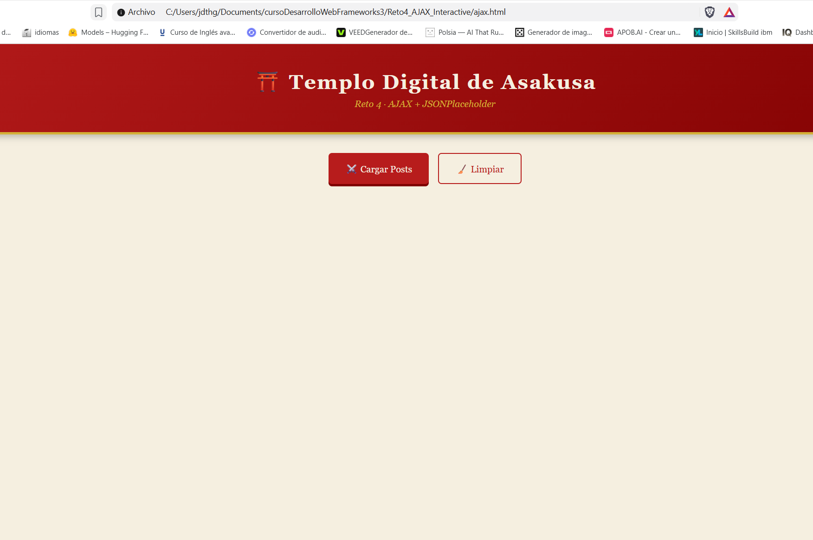

# 🏯 Reto 4 — AJAX Interactive con jQuery

[](https://developer.mozilla.org/es/docs/Web/HTML)
[](https://developer.mozilla.org/es/docs/Web/CSS)
[](https://developer.mozilla.org/es/docs/Web/JavaScript)
[](https://jquery.com/)
[](https://developer.mozilla.org/es/docs/Web/Guide/AJAX)
[]()
[]()
[](LICENSE)

> **Proyecto del curso Código Samurái (Desarrollo Web Frameworks 3)** que demuestra el consumo de una API pública mediante **AJAX con jQuery**. Los posts se cargan dinámicamente con un diseño inspirado en un templo japonés.

---

## 📌 Descripción

Página web interactiva que consume la API pública **JSONPlaceholder** usando **AJAX con jQuery**, mostrando los posts de forma dinámica con un diseño inspirado en un templo japonés.

Al hacer clic en **"Cargar Posts"**, la aplicación:
1. Muestra un **loader animado** (spinner).
2. Realiza la petición AJAX a la API.
3. Renderiza los posts recibidos en formato de tarjetas.
4. Maneja errores con mensajes diferenciados por tipo.

---

## 🛠️ Tecnologías utilizadas

<p align="center">
  
  
  
  
</p>

| Herramienta | Uso |
|---|---|
| **HTML5** | Estructura semántica del documento |
| **CSS3 puro** | Estilos personalizados (sin frameworks) |
| **jQuery 3.6.0** | Peticiones AJAX y manipulación del DOM |
| **JSONPlaceholder** | API pública para pruebas |

---

## 📁 Estructura del proyecto

```
Reto4_AJAX_Interactive/
│
├── ajax.html               # Página principal
├── api-request.js          # Lógica AJAX con jQuery
├── styles.css              # Estilos personalizados
│
├── capturas/               # Capturas de pantalla
│   ├── screenshot-1.png
│   ├── screenshot-2.png
│   └── dashboard.png
│
├── .gitignore
└── README.md
```

---

## ✨ Funcionalidades implementadas

| Funcionalidad | Descripción |
|---|---|
| **Petición GET** | `$.ajax()` a `https://jsonplaceholder.typicode.com/posts` |
| **Renderizado dinámico** | Crea tarjetas con título y cuerpo de cada post |
| **Loader animado** | Spinner visible durante la petición |
| **Manejo de errores** | Mensajes diferenciados según tipo (timeout, sin conexión, 404, 5xx) |
| **Callback `complete`** | Oculta el spinner siempre, incluso si hay error |
| **Botón Limpiar** | Elimina los posts cargados |
| **Escape HTML** | Sanitiza los datos recibidos para evitar inyecciones |

### Manejo de errores

La aplicación distingue entre:

- **Timeout** → mensaje de "servidor lento"
- **Sin conexión** → mensaje de "verifica tu internet"
- **Error 404** → recurso no encontrado
- **Error 5xx** → error del servidor
- **Error genérico** → mensaje genérico

---

## 🚀 Cómo ejecutar

1. **Clona o descarga el repositorio**:
   ```bash
   git clone https://github.com/everest9957/Reto4_AJAX_Interactive.git
   cd Reto4_AJAX_Interactive
   ```

2. **Abre el archivo `ajax.html`** en tu navegador (Chrome, Firefox, Edge...).

3. **Haz clic en el botón "Cargar Posts"**.

4. Verás un **indicador de carga** y, al terminar, una **cuadrícula con los posts**.

> **Nota**: no requiere servidor local. Usa jQuery por CDN y una API pública con CORS habilitado.

---

## 📸 Capturas de pantalla

### 1. Página principal



### 2. Posts cargados



### 3. Dashboard



---

## 🎓 Aprendizajes del reto

- **Peticiones AJAX** con `$.ajax()` y manejo del objeto `settings`.
- **Callbacks** de éxito, error y `complete`.
- **Diferenciación de errores** según el tipo (`xhr.status`, `textStatus`).
- **Manipulación dinámica del DOM** con jQuery.
- **Seguridad básica**: escape de HTML para prevenir XSS.
- **Feedback visual**: loaders y mensajes de error claros para el usuario.

---

## 🔄 Próximas mejoras

- [ ] Añadir **paginación** para los 100 posts
- [ ] Implementar **filtro por usuario**
- [ ] Añadir **búsqueda en tiempo real** por título
- [ ] Incorporar **caché local** con `localStorage`
- [ ] Migrar a **`fetch()` + async/await** como comparativa moderna
- [ ] Publicar el proyecto en **GitHub Pages** para demo online

---

## 👤 Autora

**Judit Giravent Pineda**

- GitHub: [@everest9957](https://github.com/everest9957)
- LinkedIn: [linkedin.com/in/judit-giravent-27b167156](https://linkedin.com/in/judit-giravent-27b167156)

---

## 📜 Licencia

Este proyecto está bajo la **Licencia MIT**. Consulta el archivo [LICENSE](LICENSE) para más detalles.

---

*Proyecto académico · Código Samurái · Desarrollo Web Frameworks 3*

---

⭐ Si este proyecto te ha resultado útil, considera darle una estrella en GitHub.